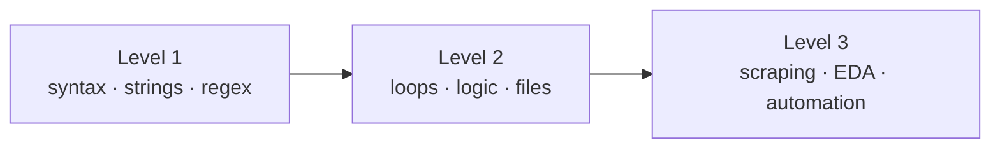

<h1 align="center">🐍 Cognifyz Python Internship</h1>

<p align="center">Thirteen tasks in three levels, from string tricks to a web scraper, an EDA tool and a file organiser.</p>

<p align="center">
  
  
  
  
</p>

## Tasks

| Level | Notebook · notes | Tasks |
|---|---|---|
| 🟢 **1 · Basics** | [`Task_1.ipynb`](Task_1.ipynb) · [notes](Task_1.md) | String reversal · temperature conversion · email validator (regex) · calculator · palindrome checker |
| 🟡 **2 · Problem solving** | [`Task_2.ipynb`](Task_2.ipynb) · [notes](Task_2.md) | Guessing game · number guesser · password strength checker · Fibonacci · word count in a file |
| 🔴 **3 · Applied** | [`Task_3.ipynb`](Task_3.ipynb) · [notes](Task_3.md) | Web scraper (Kathmandu Post articles → CSV) · Iris EDA with Matplotlib / Seaborn · file organiser that sorts a folder by type, with leftovers going to `Others/` |



## Run it

```bash
git clone https://github.com/Alpha107/Cognifyz_Internship_Tasks
cd Cognifyz_Internship_Tasks
pip install requests beautifulsoup4 pandas matplotlib seaborn
jupyter notebook
```

## Status & known issues

| Issue | Effect |
|---|---|
| The old clone command pointed to `Alpha107/Cognifyz` and `cd cognify` | Fixed above |
| The old README listed 4 Level 2 tasks, but the notebook has 5 (Number Guesser) | Table corrected |
| Scraper selectors are tied to the Kathmandu Post's HTML | Breaks when the site changes its layout |
| Plots live only inside `Task_3.ipynb` | Nothing to preview on GitHub without opening the notebook |
| File organiser moves real files | Try it on a copy of a folder first |

## Roadmap

- [ ] Export the Level 3 tools as `.py` scripts with CLI arguments
- [ ] Add screenshots of the EDA plots
- [ ] Unit tests for the Level 1–2 functions
